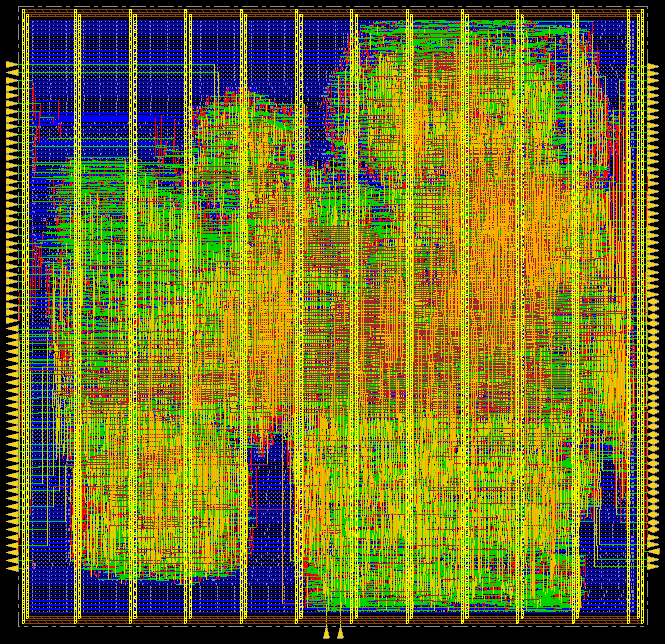
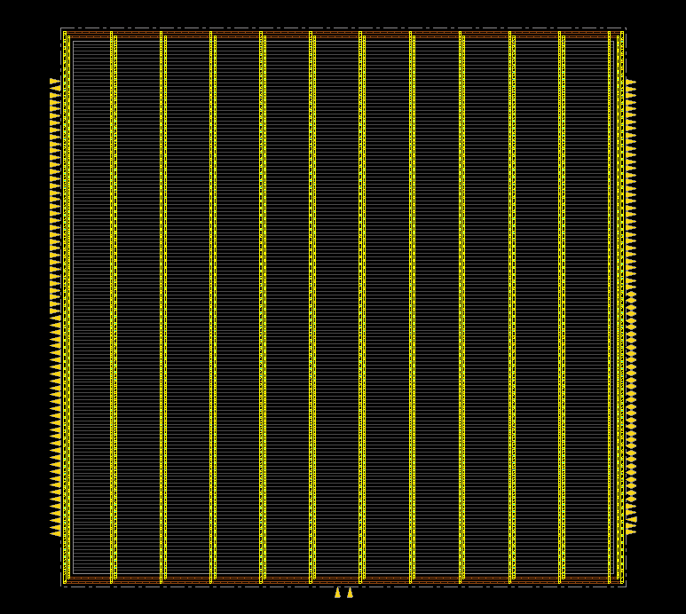
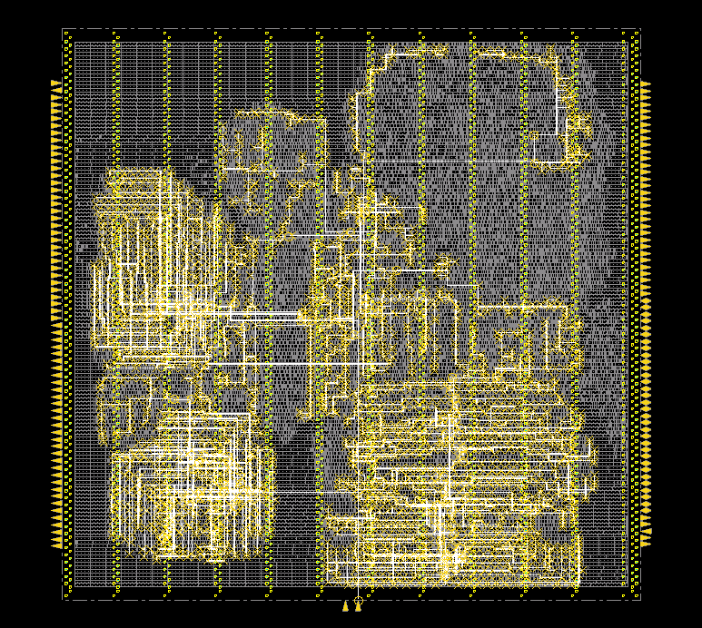
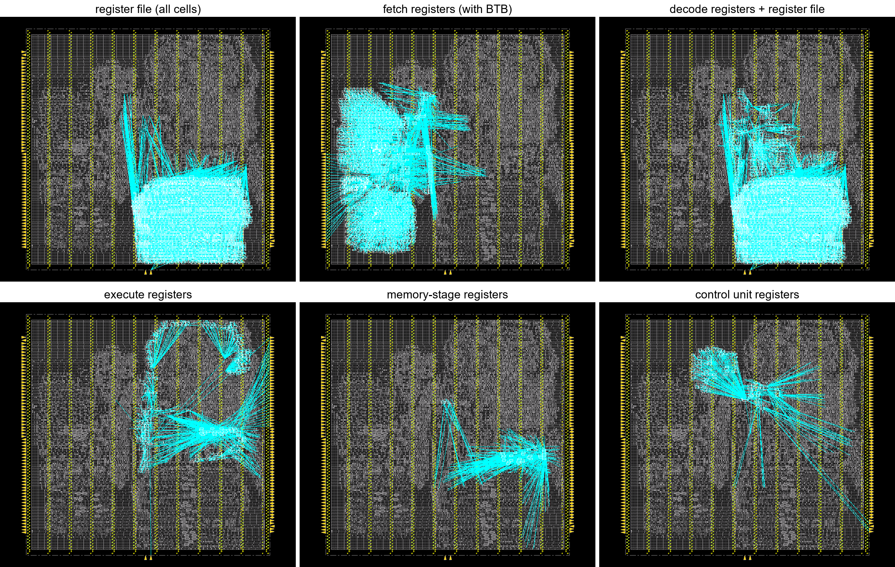

# Physical design

Place and route of the fastest V6 netlist (the 1.0 ns synthesis run, which
achieved 1.4096 ns) with Cadence Innovus 23.35 and the Nangate OpenCell 45 nm
library, followed by a simulation of the routed netlist with its extracted
delays and a power analysis driven by that simulation's switching activity.



## Results

| | Synthesis | After place and route |
|---|---:|---:|
| Achieved period | 1.4096 ns (709 MHz) | **1.2726 ns (786 MHz)** |
| Setup slack at the 1.4096 ns clock | 0 | +0.137 ns |
| Hold slack (typical corner) | — | +0.055 ns |
| Cell area | 27,888 µm² | 27,304 µm² |
| Cells (without fillers) | — | 15,591 |
| Core / die side | — | 215.7 / 225.9 µm |
| Cell density | — | 58.7 % |
| Signal wire length | — | 209.6 mm |
| DRC / connectivity / antenna violations | — | 0 / 0 / 0 |
| Test programs passing, routed netlist with SDF | — | 24 / 24 |

The layout is 10 % faster than the synthesis estimate and 2 % smaller,
although clock and reset buffers were added: the wire-load model of synthesis
is pessimistic for a design of this size, and Innovus keeps optimising the
real critical paths with the extracted parasitics. The critical path is the
same family synthesis reported: the `rs2` address registered in ID, the
forwarding unit's address comparison, the operand multiplexer, the Booth
encoder and two full-adder levels of the Dadda tree, into the multiplier's
first pipeline register.

Source tables: [`../data/pd_results.csv`](../data/pd_results.csv),
[`../data/pd_corners.csv`](../data/pd_corners.csv).

### Clock tree

CCOpt builds the tree with `CLKBUF_X1`–`X3` for 2,835 flip-flops behind the
74 clock gates Design Compiler inserted. Only 24 buffers are needed, because
the gates split the clock into 74 small subtrees. Insertion delay is
0.102–0.136 ns, skew 0.034 ns (target 0.05 ns), clock wire 13.3 mm.

| Power grid (metal9/metal10 only) | Clock nets |
|---|---|
|  |  |

### Placement



The netlist is flat except for the register file, so the pipeline stages are
shown through their registers. Placement follows the dataflow: fetch and BTB
near the instruction-memory pins on the left, the register file at the bottom
centre, execute and memory towards the data-memory pins on the right, the
control unit in the middle.

### Post-layout power

The routed netlist is simulated with its SDF at 1.28 ns (the achieved period
rounded up to 10 ps); a SAIF records the activity from the end of reset to the
program's final loop, and Innovus reports power on the extracted design with
100 % of the nets annotated.

| Workload | Power after layout | Energy per run | Synthesis energy | Change |
|---|---:|---:|---:|---:|
| mixed, `20_power_bench` | 13.76 mW | 49.5 nJ | 43.5 nJ | +14 % |
| multiply-accumulate, `24_mac_loops` | 15.42 mW | 84.4 nJ | 74.2 nJ | +14 % |
| multiplier, `08_multiplier` | 16.12 mW | 1.44 nJ | 1.34 nJ | +8 % |

The extra energy comes from the clock tree (absent in synthesis), the real
wire capacitance and the glitches that an SDF-annotated simulation exposes
and a zero-delay one hides. On the mixed workload 58 % of the power is
internal, 38 % switching and 4 % (0.54 mW) leakage. Energy is the fair
comparison here, because the layout runs at a shorter period. Source:
[`../data/pd_power.csv`](../data/pd_power.csv).

### Post-layout simulation

The routed netlist runs the whole regression (tests 01–24) with the SDF from
the extracted parasitics and the cell timing checks active. All 24 programs
pass, and every one takes exactly the RTL cycle count
([`../data/postlayout_verification.csv`](../data/postlayout_verification.csv)).
This explains a small difference found earlier: four programs took one or two
cycles more or less in the zero-delay gate-level simulation. With real
delays they match the RTL, so that difference was an artefact of zero-delay
simulation, not a property of the netlist.

### Corners

The flow optimises the typical corner and only reports the others. At the
slow corner (125 °C) the design would run at 4.48 ns; at the fast corner 11
register-to-register paths miss hold by at most 6 ps. A multi-corner flow
would add the fast view to the hold optimisation.

## Flow

| Step | Work |
|---|---|
| 00 | import netlist, LEF, MMMC views and SDC; design checks |
| 01 | square floorplan, 60 % utilisation; instruction-memory pins left, data-memory pins right |
| 02 | power ring and vertical metal10 stripes every 20 µm; metal1 follow-pin rails |
| 03–04 | timing-driven placement, tie cells, pre-CTS optimisation |
| 05–06 | clock tree synthesis, post-CTS setup and hold optimisation |
| 07–08 | timing-driven routing with antenna fixing; post-route optimisation with on-chip variation |
| 09 | fillers; DRC, connectivity and antenna checks |
| 10 | extraction, final timing, power, area; netlist, SDF, SPEF, DEF |
| 11 | slow-corner setup and fast-corner hold, report only |

The synthesis SDC is reused with the Design-Compiler-only lines removed.
One constraint is added: `RST` gets an input delay of half a period, since
the testbench releases it on the falling edge. Without it the reset tree was
unconstrained, and the first runs failed 26 of 27 post-layout simulations.
The connectivity check caught a second problem in an earlier grid: horizontal
metal9 stripes lying over the follow-pin rails blocked their via stacks and
left 12 rails floating. They were removed; the vertical stripes tap every rail.

## Files

```text
scripts/innovus_script.tcl    the flow, steps 00-11
scripts/dlx.globals           design import
scripts/Default.view          MMMC: libraries, RC corners, views
scripts/power_postlayout.tcl  power from a SAIF
scripts/snapshots.tcl         layout pictures (GUI)
scripts/sim_postlayout.do     routed netlist + SDF through the regression
scripts/run_pd.sh, run_power.sh, collect_pd_results.py
reports/                      the run's reports: checks, CTS, timing, area, power, DRC
figures/                      layout pictures
```

The routed netlist, SDF, SPEF and DEF are not included, like the synthesis
netlists. Electromigration, IR drop and thermal behaviour were not analysed.
