# DLX architecture schematics

Structural sheets of the processor, generated from the VHDL and checked
against it: every port and internal signal of the drawn entity appears on its
sheet. Each sheet is an SVG (for viewing) and a draw.io file (for editing).

The stage sheets show the common structure of all versions as drawn from the
baseline (V0); the revisions that changed it are described in
[`../doc/revisions.md`](../doc/revisions.md). The fetch sheet and the
component sheets show the final design, V6.

| Sheet | Scope | RTL |
|---|---|---|
| 01 | Top-level DLX and memory interfaces | V0 |
| 02 | Five-stage datapath | V0 |
| 03 | Fetch: PC selection, BTB lookup, registered BTB update, IF/ID | V6 |
| 03b | Branch target buffer: lookup and update | V6 |
| 04 | Control path: decoder, control pipeline, hazards, forwarding | V0 |
| 05 | Decode: register files, branch correction, exceptions, ID/EX | V0 |
| 06 | Execute: forwarding multiplexers, functional units, EX/MEM | V0 |
| 06b | Booth/Dadda multiplier | V6 |
| 07 | Memory access and exception detection | V0 |
| 09 | Branch correction: targets and misprediction | V6 |
| 09b | Decision unit: branch condition from stored and forwarded flags | V6 |
| 09p | P4 adder: sparse carry tree and carry-select sum | V6 |
| 13 | Hazard detection: scoreboards and stall | V6 |
| 14 | Forwarding unit | V6 |

On the V0 sheets, three revisions change the drawn interfaces
([`../doc/revisions.md`](../doc/revisions.md)): V1 removes the MEM→ID
forwarding path (`fw_mem_id_rs1`, `register_in_mem`); V3 adds the sign/zero
bits stored with each register (decode, execute, write-back); V4 registers the
BTB update and removes the BTB invalidation (fetch, already drawn as V6).

## 01 — system overview

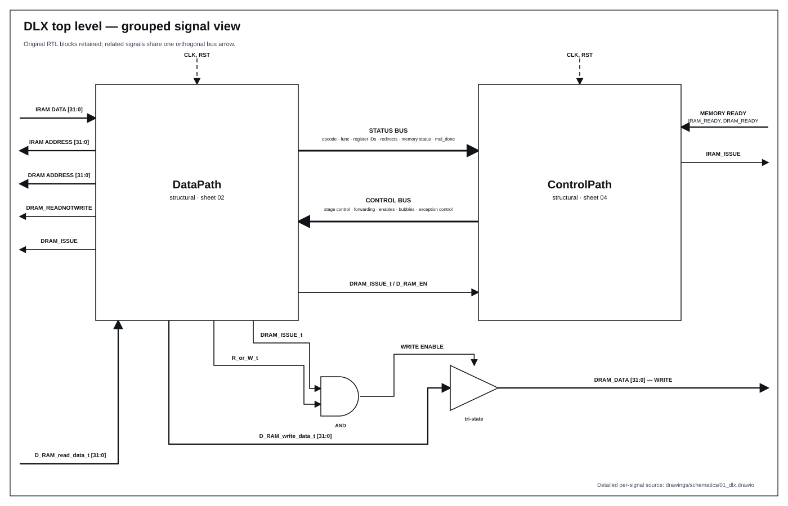

## 02 — complete datapath

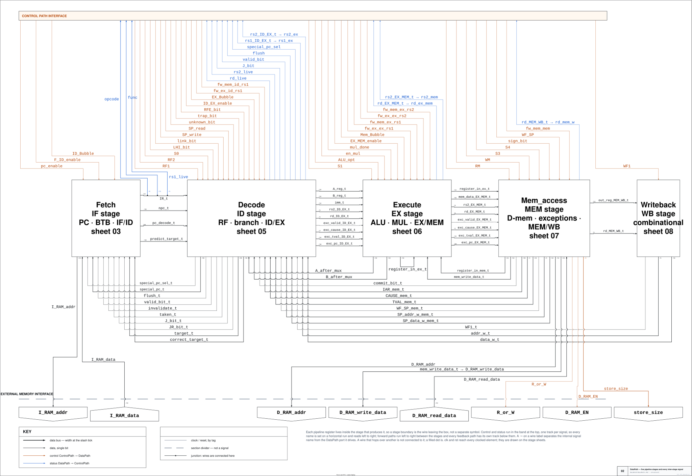

## 03 — fetch

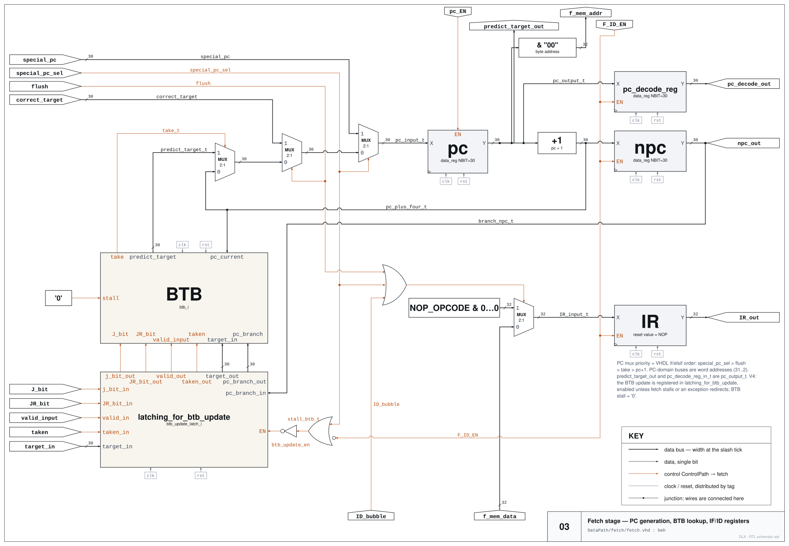

## 03b — branch target buffer

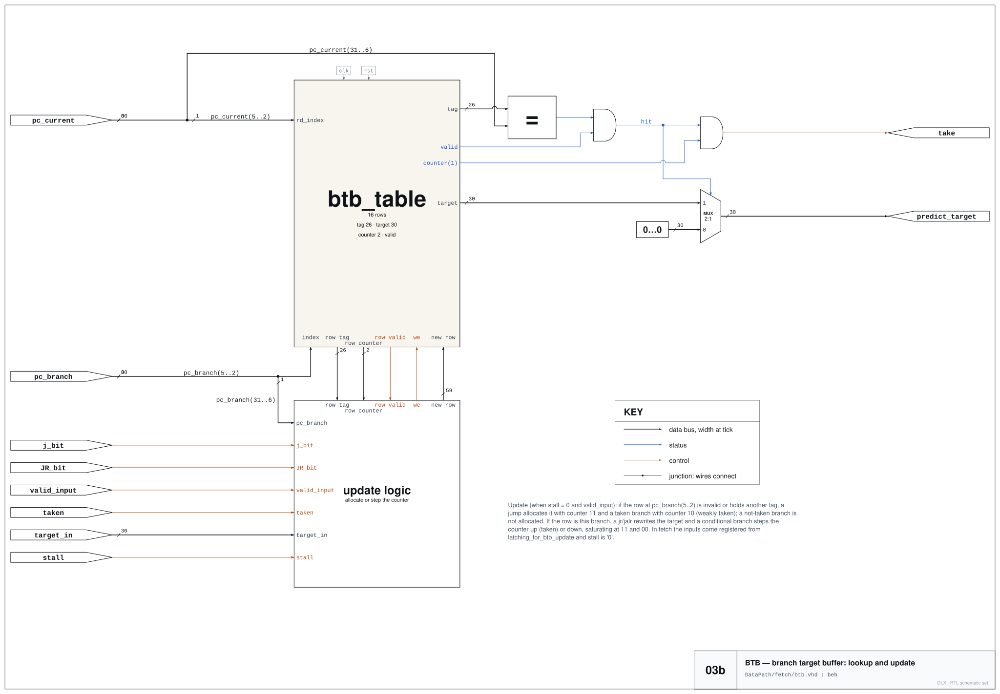

## 04 — control path

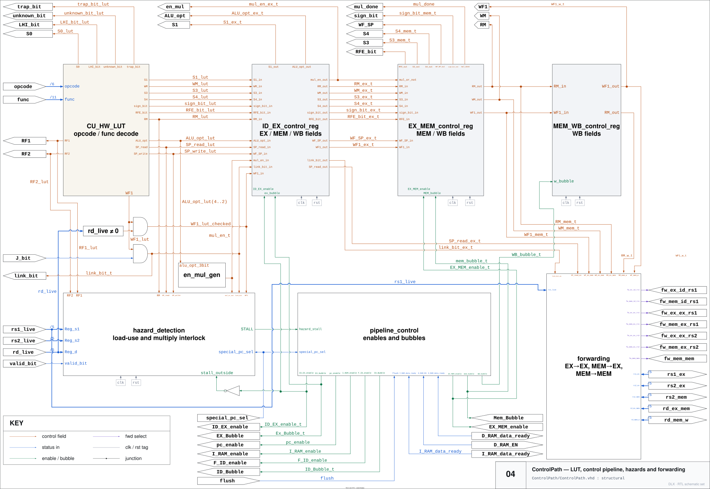

## 05 — decode

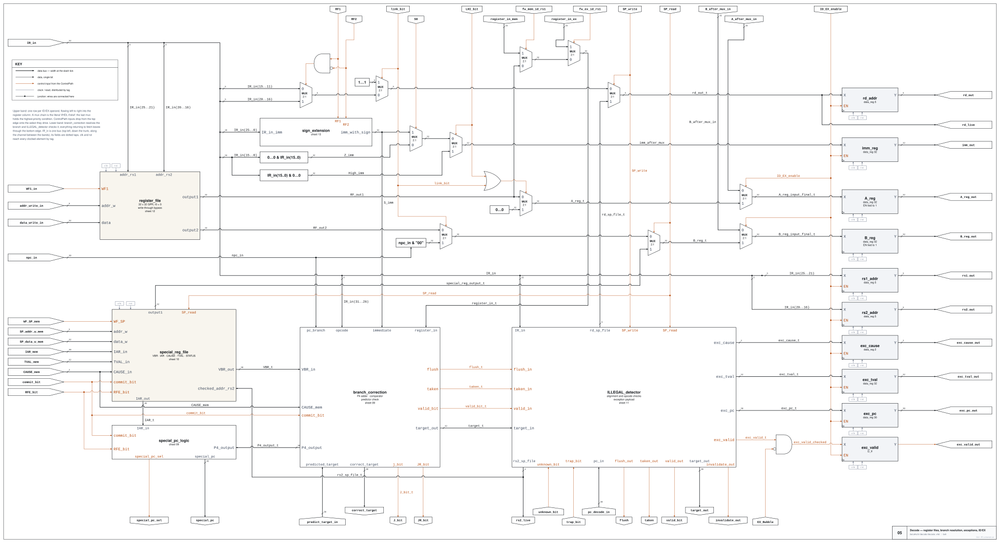

## 06 — execute

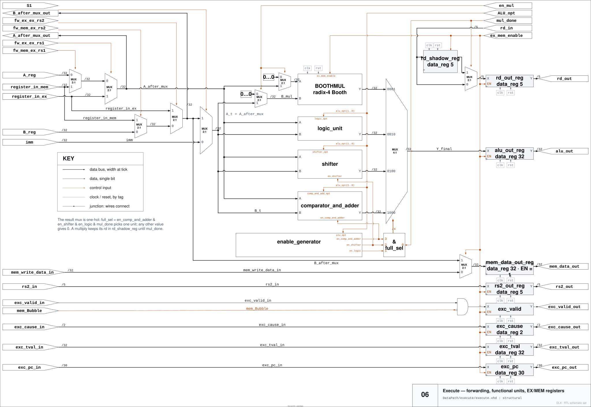

## 06b — multiplier

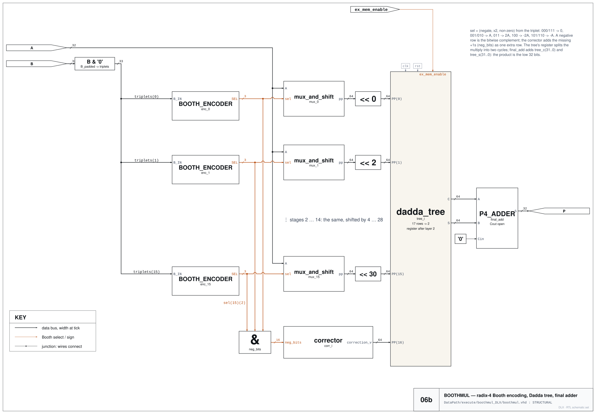

## 07 — memory access

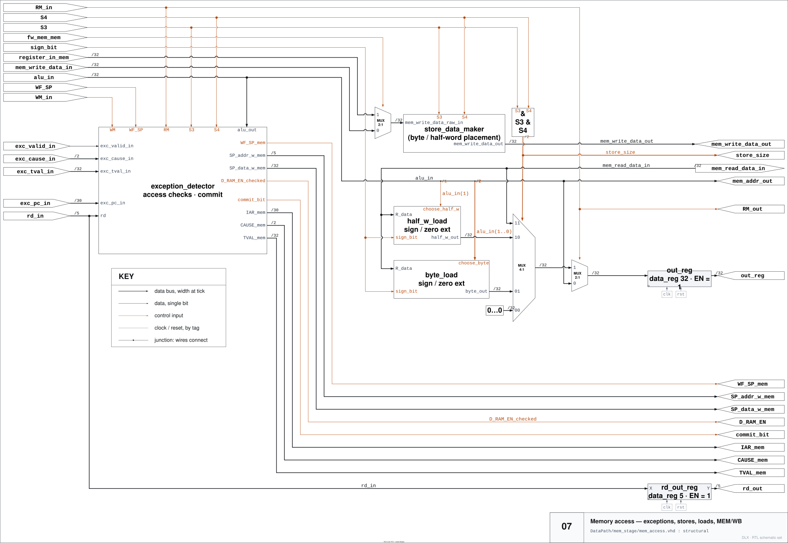

## 09 — branch correction

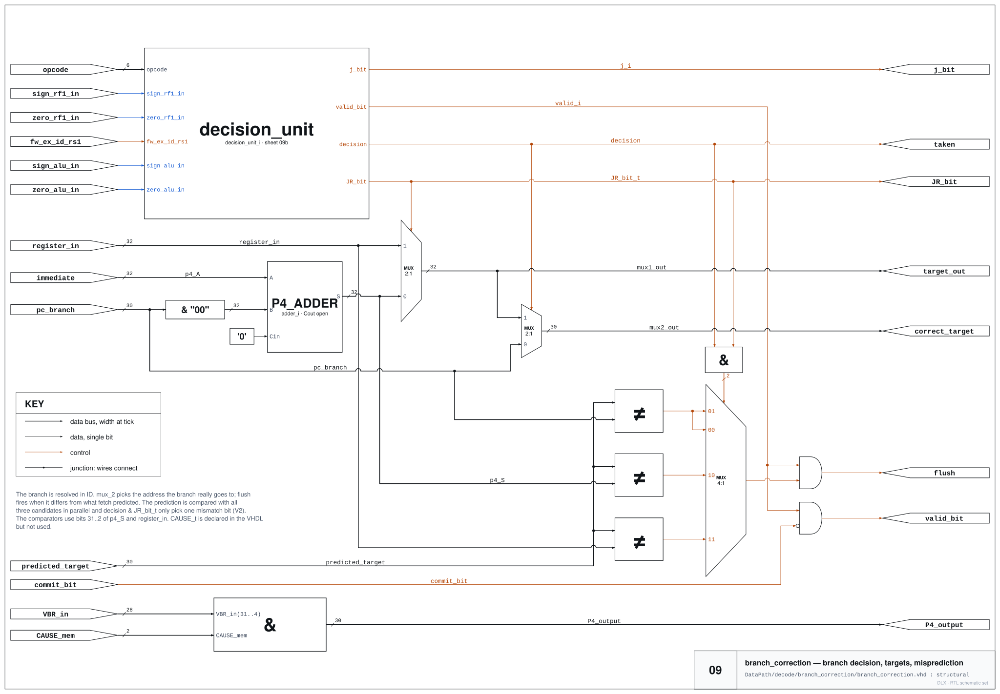

## 09b — decision unit

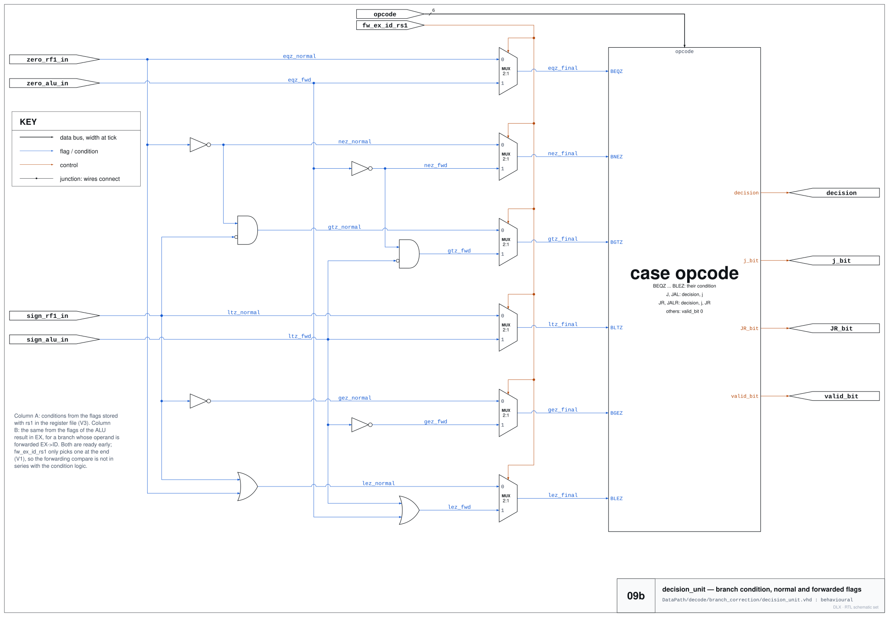

## 09p — P4 adder

The carry tree is generated from the same rules as the VHDL generate loops,
so it matches the RTL by construction.

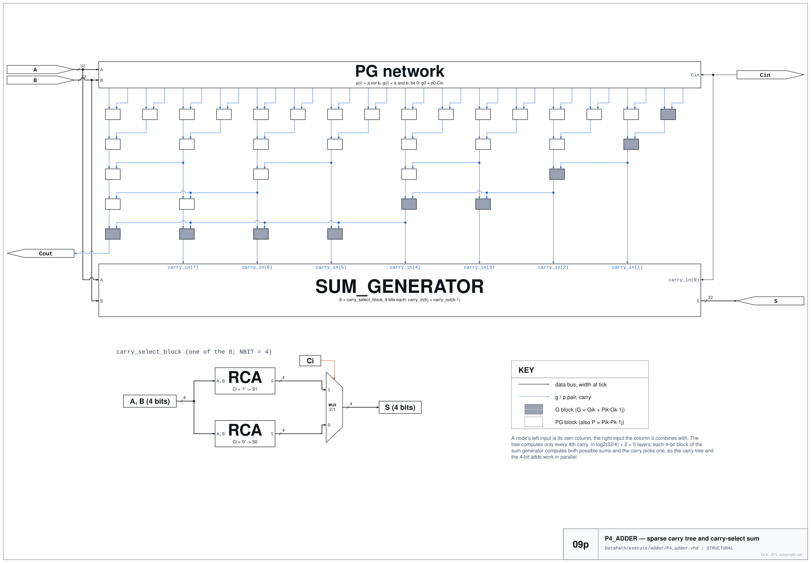

## 13 — hazard detection

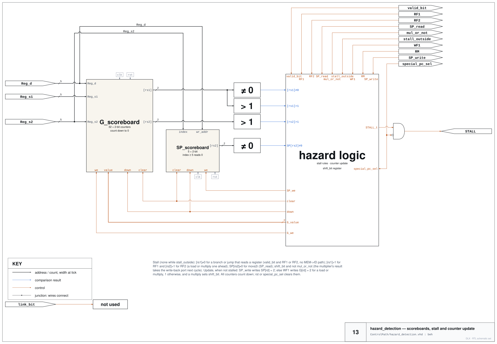

## 14 — forwarding

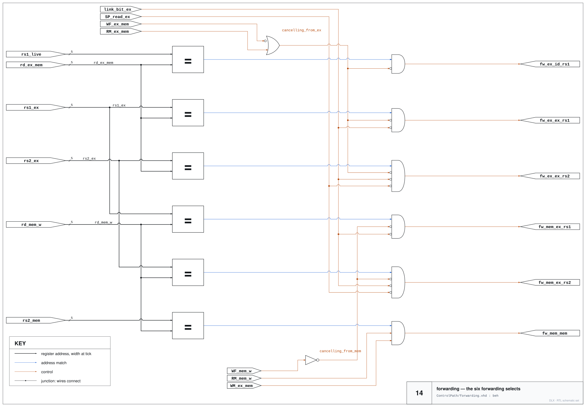
